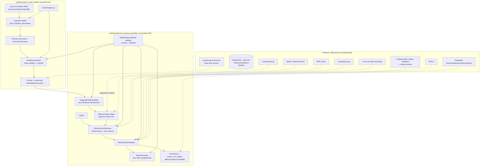

# Measured RAG — Architecture

This document describes the **current** architecture of `measured-rag` as implemented in the repository and distinguishes implemented, partially implemented/runtime-unverified, and planned components. It is based on source inspection (`src/measured_rag/`, `scripts/`, `configs/`, `tests/`, existing docs) and does **not** claim runtime results that have not been verified here.

## 1. Overall system architecture

**Objective:** a modular, strategy-switchable, evaluation-first cybersecurity RAG system for comparing retrieval strategies with reproducible, measured evidence.

**High-level pipeline (target):** corpus/manifest ingestion → chunking → (optional index-time enrichment) → embedding/indexing → retrieval (strategy) → optional reranking → grounded generation → programmatic citation/refusal validation → evaluation/reporting and artifact persistence.

**Current state:** M0 foundation and **M1 baseline components are partially implemented in code**. A deterministic ingest+chunk CLI exists; DB-backed indexing/query, live embedding/model downloads in end-to-end runs, live LLM generation, evaluation execution, and advanced retrieval strategies are **not completed/runtime-verified as an end-to-end system**.

## 2. Component responsibilities

| Component | Location | Responsibility | Status |
|---|---|---|---|
| Configuration | `src/measured_rag/config/settings.py` | Load/validate env-backed `AppSettings`; defaults (chunking, retrieval, generation timeout, embedding/LLM/DB); build SQLAlchemy URL; cached `get_settings()` | **Implemented** (env/`.env`); **YAML runtime loading not implemented** |
| Domain entities | `src/measured_rag/domain/entities.py` | `SourceProvenance`, `Document`, `Chunk` (with optional `enriched_text`), `RankedResult`, `Citation`, `Answer` dataclasses | **Implemented** (minimal) |
| Ingestion | `src/measured_rag/ingestion/loader.py` | Parse manifest, require provenance/licensing/local path fields, load local files, produce `Document`s with metadata/provenance | **Implemented** |
| Chunking | `src/measured_rag/chunking/base.py`, `fixed.py` | `Chunker` interface; fixed-size chunking with overlap, validation, provenance/offset metadata, `from_settings` | **Implemented** (fixed baseline only) |
| Embeddings | `src/measured_rag/embeddings/base.py`, `huggingface.py` | `Embedder` interface; lazy `sentence-transformers` embedding with CPU/batch/normalize/cache settings | **Implemented in code**; **end-to-end runtime not verified here** (model/deps/downloads on use) |
| Indexing/storage helper | `src/measured_rag/indexing/vector_store.py` | pgvector-oriented source/chunk/embedding upserts and cosine-distance search (`<=>`, score as `1-distance`) via SQLAlchemy Core | **Implemented in code**; **requires approved Postgres+pgvector, schema/migrations, and runtime deps** |
| Retrieval | `src/measured_rag/retrieval/base.py`, `vector.py` | Retriever interface/registry; dense vector retrieval (embed query → store search), attach retrieval latency metadata | **Implemented in code** (dense only); **live DB-backed retrieval not verified** |
| Generation | `src/measured_rag/generation/base.py`, `prompts.py`, `ollama.py` | Provider/result abstractions; grounded prompt/context formatting; Ollama HTTP adapter with lazy `httpx`, timeout from settings, usage recorded only if reported | **Implemented in code**; **live generation not verified** (requires Ollama service/model) |
| Pipeline/artifacts | `src/measured_rag/pipeline/query.py` | Orchestrate retrieve→prompt→generate; compute latencies; persist JSON `RunArtifact` (usage `N/A` if unavailable, never estimated; indexing cost marked separate/N/A) | **Implemented in code**; **real persisted end-to-end artifacts not produced/verified** |
| Database utilities | `src/measured_rag/db/engine.py`, `models.py`, `migrations/README.md` | Engine/session helpers, connectivity check, declarative `Base` placeholder, migrations placeholder note | **Partially implemented/skeleton**; **no applied M1 schema/migrations** |
| CLI (current) | `scripts/ingest.py` | Load manifest + fixed chunk via settings and print deterministic summary (no DB/services/models) | **Implemented and functional (previously verified in project context; not re-executed in this phase)** |
| Tests | `tests/unit/*.py`, `tests/conftest.py` | Config/domain and mocked M1 wiring tests | **Implemented** (mocked; runtime external deps/services not required) |

## 3. Data ingestion and provenance

- **Source of truth for corpus inputs:** `data/raw/source_manifest.yaml` (example: `source_manifest.example.yaml`). Loader: `measured_rag.ingestion.loader.load_manifest_documents`.
- **Required per-source fields:** `id`, `title`, `source_url`, `publication_date`, `license_or_terms`, `local_path` (validated; missing fields raise `ValueError`).
- **Behavior:** resolves `local_path` (absolute or relative to inferred base), reads UTF-8 content, constructs `Document` with `SourceProvenance` (`source_url`, `title`, `publication_date`, `version`, `license_or_terms`) and metadata (`source_id`, `local_path`, `format`, `notes`).
- **Provenance propagation:** chunk metadata copies source provenance fields from the document (see chunking). Project-level corpus attribution/licensing notes: `docs/corpus_sources.md` (read-only for this phase except prior approved edits).
- **Limitations:** manifest/YAML structure is simple; loader base-dir inference is heuristic (`manifest.parent.parent.parent` by default) and may require `--base-dir` in other layouts.

## 4. Chunking strategy

- **Implemented:** `FixedSizeChunker` (`chunking/fixed.py`) with `chunk_size` and `chunk_overlap` (from `AppSettings` via `from_settings` or explicit args).
- **Validation:** `chunk_size > 0`, `chunk_overlap >= 0`, `chunk_overlap < chunk_size`.
- **Behavior:** character-window slicing with step `chunk_size - chunk_overlap`; preserves original chunk `text`; emits chunk IDs `{document.id}::chunk-{index}`; records offsets (`start_char`, `end_char`), `chunk_index`, strategy params, and document/source provenance metadata.
- **Planned/deferred:** structure-aware chunking and other strategies (not implemented).

## 5. Embedding architecture

- **Interface:** `embeddings.base.Embedder` (`embed_texts`, `embed_query`, `dimension`).
- **Implementation:** `HuggingFaceEmbedder` (`embeddings/huggingface.py`) using `sentence-transformers` loaded **lazily** on first embed call; defaults aligned with settings (`sentence-transformers/all-MiniLM-L6-v2`, CPU, batch size, normalization, optional in-memory cache).
- **Status:** code present and configurable; **runtime execution not verified** in this phase (requires installed dependencies and model availability/download on first use). No GPU required by design.

## 6. Vector indexing design

- **Implementation:** `indexing.vector_store.PgVectorStore` with parameterized SQL for:
  - `sources` upsert (id/title/url/dates/version/license/metadata JSON)
  - `chunks` upsert (id/source/document/index/text/optional `enriched_text`/metadata JSON)
  - `chunk_embeddings` upsert (vector, model id, dimension, index version)
  - `search` by cosine distance using pgvector operator `<=>`, returning `RankedResult` with `score = 1 - distance`
- **Status:** **implemented in code only**. Requires a running PostgreSQL instance with `pgvector`, compatible tables/schema/migrations, and an approved runtime environment. `ensure_extension_sql()` exists but schema creation/migrations are **not applied/implemented** in-repo.
- **Integrity note:** indexing cost is intended to be recorded separately per indexing run (pipeline marks indexing cost as N/A for query runs).

## 7. Retrieval architecture

- **Interface/registry:** `retrieval.base.Retriever` and `register_retriever` (`dense_vector` registered).
- **Implemented strategy:** `DenseVectorRetriever` embeds the query and queries `PgVectorStore.search(top_k=...)`, returning ranked results and attaching measured retrieval latency in metadata.
- **Planned/deferred:** BM25/sparse, hybrid dense+sparse, RRF fusion, cross-encoder reranking, and other switchable strategies (**not implemented**).

## 8. Generation architecture

- **Provider abstraction:** `generation.base.LLMProvider` / `GenerationResult` (text, model, provider, usage if available, latency, raw).
- **Grounded prompting:** `generation.prompts.format_context` and `build_grounded_prompt` instruct the model to answer from provided context, cite `chunk_id`s, and state insufficiency when unsupported. **Prompting is not programmatic citation validation.**
- **Implemented provider:** `generation.ollama.OllamaProvider` (`/api/generate`, non-streaming, `temperature` override via kwargs, lazy `httpx` import; network only on `generate()`), configurable via settings (`OLLAMA_BASE_URL`, `OLLAMA_MODEL`, `GENERATION_TIMEOUT_S`).
- **Planned/deferred:** OpenAI-compatible runtime adapter usage beyond config placeholders (**not implemented/verified**), refusal/citation enforcement (**not implemented**).

## 9. Pipeline execution and artifact recording

- **Implementation:** `pipeline.query.BaselineRAGPipeline` orchestrates retrieval → context/prompt assembly → generation; `persist_run_artifact` writes JSON `RunArtifact`.
- **Recorded measurements (by design):** retrieval latency, end-to-end latency, `top_k`, provider/model/generation latency metadata; **token/model usage recorded only if provider reports it, else `N/A` (never estimated)**; indexing cost noted as separate/N/A for query runs.
- **Status:** orchestration/persistence code exists; **no verified end-to-end persisted run artifacts** from a live baseline in this phase. Reproducibility fields (e.g. config hashes/dataset versions) are **not fully implemented**.

## 10. Configuration flow

- **Runtime source:** `AppSettings` (`pydantic-settings`) reads environment variables and optional `.env` (`extra="ignore"`, case-insensitive). Cached via `get_settings()`.
- **Key settings:** chunking (`CHUNK_SIZE`, `CHUNK_OVERLAP`), retrieval (`TOP_K`), generation (`GENERATION_TIMEOUT_S`, `LLM_PROVIDER`, `OLLAMA_*`, optional OpenAI-compat fields), embeddings (`EMBEDDING_*`), DB (`POSTGRES_*`/`DATABASE_URL`), paths/resource controls (`DATA_DIR`, `CONFIG_DIR`, `CACHE_DIR`, `SEED`, `MAX_TOP_N_RERANK`, `RRF_K`).
- **Config files:** `.env.example`, `configs/app.example.yaml`, `configs/experiments/01_baseline_vector.yaml`, `configs/eval/default_eval.yaml` are provided for reference/alignment. **Automatic YAML experiment/app config loading is not implemented.**

## 11. Database architecture and migration status

- **Intended store:** PostgreSQL with `pgvector` (local/Docker recommended).
- **Current code:** `db.engine` provides engine/session helpers and a simple connectivity check; `db.models.Base` is an **M0 placeholder** (no M1 tables defined in ORM); `db/migrations/README.md` states migrations will be introduced later.
- **Vector store expectations (code-level):** tables such as `sources`, `chunks`, `chunk_embeddings` with pgvector column/operations as implied by `PgVectorStore` SQL.
- **Migration status:** **No Alembic migrations applied/implemented for schema creation in the repository; schema not verified.** DB-backed components are **not runnable** without approved setup.

## 12. Current limitations

- No end-to-end baseline run verified (embed → index → retrieve → generate → persist real artifacts).
- No applied DB schema/migrations; no `scripts/index.py` or `scripts/query.py`.
- Evaluation framework, datasets, metrics computation, and reports are **not implemented** (placeholder config only).
- YAML config loading not implemented; experiment configs are reference artifacts.
- Only fixed chunking and dense vector retrieval are implemented; no hybrid/RRF/reranking/contextual retrieval.
- No programmatic citation-ID validation, refusal enforcement, or separate citation/faithfulness/refusal metrics.
- `ingestion.loader` base-dir inference is heuristic; may need explicit `--base-dir` outside expected layout.
- `HuggingFaceEmbedder` lazy-loads/caches at runtime; cache behavior and runtime performance are **not verified** here.

## 13. Planned milestones (high level)

- **M1 completion:** DB schema/migrations, indexing/query CLIs, approved runtime deps/services, verified end-to-end baseline with measured artifacts.
- **M2 (evaluation-first):** fixed/versioned dataset, automated retrieval/answer metrics, integrity logging, reproducible reports before further upgrades.
- **M3–M7:** structure-aware chunking, BM25/hybrid retrieval, RRF fusion, cross-encoder reranking, contextual retrieval (index-time primary; query expansion separate/optional).
- **M8:** programmatic citation validation and refusal handling with separate metrics.
- **M9–M11:** dataset expansion/comparative reporting, API/UI, hardening/documentation.

**Unverified:** milestone sequencing beyond repository evidence and prior project context should be treated as planned intent, not a committed/verified schedule.
